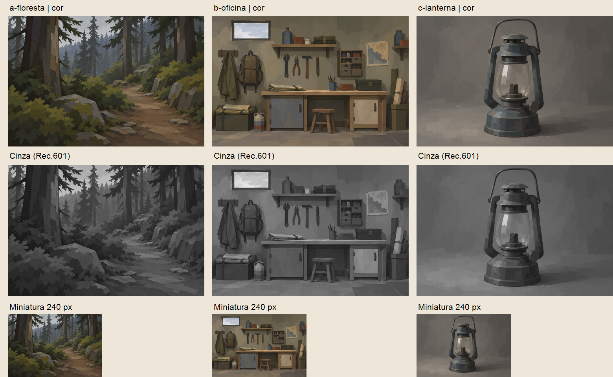

# Estudos visuais — seleção validada

[Catálogo oficial das referências](../illustration-references.md): identificação, características compartilhadas, origem, prompts correspondentes e hashes dos originais. Este relatório mantém a avaliação dos estudos e os limites dos recortes.

## Seleção

Em 25/10/2026, após revisão visual com o usuário, foram mantidos apenas os três estudos escolhidos como referência artística. As variantes descartadas foram removidas do repositório a pedido do usuário. A oficina frontal refinada (antes identificada como F) passa a usar o nome canônico `b-oficina.png`, sem alterar seus pixels.

| Assunto | Arquivo validado | Características de referência |
| --- | --- | --- |
| Floresta | [a-floresta.png](a-floresta.png) | Caminho legível, planos atmosféricos, vegetação agrupada e pintura por massas. |
| Oficina | [b-oficina.png](b-oficina.png) | Composição frontal e profundidade rasa; detalhes estruturais integrados a planos simples, sem rabiscos ou desgaste espalhado. |
| Lanterna | [c-lanterna.png](c-lanterna.png) | Objeto reconhecível por silhueta, peças essenciais e planos de cor; linguagem pictórica sem depender de cenário. |

Os três originais são PNG 1536 × 1024, proporção 3:2. A seleção artística não aprova banners comerciais, recortes indiscriminados nem acessibilidade de texto sobreposto.

## Pranchas

- [Comparação em cor, cinza e miniatura](comparacao.png), atualizada com a oficina validada.
- [Recortes desktop/mobile](recortes.png), atualizados com a mesma seleção.
- [Prompts e parâmetros](prompts.md), com histórico textual de geração e identificação dos arquivos atuais. Os nomes antigos nesse histórico não representam imagens ainda disponíveis no projeto.

## Avaliação técnica da seleção

A aprovação do usuário determina a seleção artística. A avaliação técnica abaixo registra limites que continuam pertinentes, sem desfazer essa escolha.

| Critério | Floresta | Oficina validada | Lanterna |
| --- | --- | --- | --- |
| Formas | **Aprovado:** troncos, pedras e caminho legíveis. | **Aprovado:** ferramentas, alças, gavetas, dobras e apoios claros. | **Aprovado:** pega, suportes, base e câmara reconhecíveis. |
| Pinceladas | **Parcial:** planos largos, vegetação ainda com muitas subdivisões. | **Aprovado:** grandes planos e detalhes simples subordinados à cena. | **Parcial:** manchas largas, mas alguns contornos muito regulares. |
| Texturas | **Aprovado:** materiais diferenciados sem textura fotográfica. | **Aprovado:** menor patina e ruído, materiais por formas/planos. | **Parcial:** metal fosco legível; vidro ainda relativamente opaco. |
| Contornos | **Aprovado:** definição decresce no fundo. | **Parcial:** silhuetas claras, poucas bordas perdidas nos objetos. | **Parcial:** silhueta firme em quase toda extensão. |
| Iluminação | **Aprovado:** luz nublada e profundidade coerente. | **Aprovado:** luz contida e sombras simples sem brilho dominante. | **Aprovado:** luz à esquerda e sombra de apoio à direita. |
| Cores | **Parcial:** olivas claros ainda se destacam em arbustos. | **Aprovado:** neutros e apoios foscos sem saturação generalizada. | **Aprovado:** azul-cinza contido e ambiente neutro. |
| Detalhamento | **Parcial:** algumas marcas pequenas na folhagem. | **Aprovado:** detalhe dá forma sem competir com os planos maiores. | **Aprovado:** peças funcionais suficientes, sem minúcia mecânica. |
| Atmosfera | **Aprovado:** caminho calmo e circulação legível. | **Aprovado:** organização e equipamentos íntegros sugerem cuidado. | **Parcial:** sobriedade e integridade; acolhimento menos explícito no objeto isolado. |
| Identidade | **Aprovado como seleção artística:** pintura ambiental por massas. | **Aprovado como seleção artística:** frontal pictórica e detalhes integrados. | **Aprovado como seleção artística:** tratamento pictórico no próprio objeto. |

Os três assuntos são identificáveis em miniatura de 240 px e conservam separação essencial em cinza. A oficina agora concentra a leitura na bancada e no conjunto de ferramentas; seus objetos laterais são apoios narrativos. Não foram observadas falhas impeditivas evidentes de apoio, identificação ou perspectiva essencial. A lanterna é uma ilustração plausível, não projeto mecânico.

A amostra é uma referência artística validada pelo usuário, mas não comprova geração repetível: houve refinamentos e uso de referências distintas. A avaliação técnica foi feita pelo mesmo agente que formulou os prompts, sem revisão independente cega.

## Recortes e limites

Recortes diagnósticos iguais para os três originais: desktop 16:7 `(0,176,1536,672)`; mobile próximo de 4:5 `(358,0,820,1024)`, em x/y/largura/altura. As pranchas são reduções desses recortes.

| Recorte | Floresta | Oficina validada | Lanterna |
| --- | --- | --- | --- |
| Desktop central | **Parcial:** caminho preservado, perde enquadramento superior. | **Parcial:** bancada/ferramentas preservadas, corta partes superiores e inferiores. | **Reprovado:** corta pega e base; exige composição própria. |
| Mobile central | **Aprovado para leitura:** caminho e profundidade permanecem. | **Parcial:** conjunto central preservado, perde mochila e outros apoios laterais. | **Aprovado para leitura:** pega, câmara e base preservadas. |

Nenhum recorte foi aprovado como hero com texto. Oficina exige recomposição mobile se mochila e objetos laterais forem essenciais; lanterna exige variante desktop com objeto menor/deslocado. Texto fora da imagem ou painel protegido deve ser estudado conforme a [especificação](../illustration-language.md). Contraste de texto/foco e comportamento HTML não foram testados.

## Ferramentas, referências e aprendizado

Ferramenta integrada `image_gen.imagegen`, fundo opaco, tamanho solicitado e observado 1536 × 1024. Modelo efetivo, seed, sampler e qualidade não expostos. Floresta e lanterna foram geradas com contexto visual incluindo a garagem anexada e saídas recentes. A oficina foi editada a partir da frontal anterior com a garagem como referência técnica. Essas entradas históricas foram removidas do projeto quando descartadas; não há promessa de reprodução exata apenas pelos prompts.

Originais preservados sem filtros. Pranchas montadas com System.Drawing disponível no sistema, sem instalar dependências: redução, recorte e mistura RGB Rec.601 (0,299/0,587/0,114) para cinza. Esse diagnóstico não é cálculo de luminância WCAG. Nenhuma imagem protegida foi copiada ao repositório.

Links e créditos conhecidos de Life is Strange (2015), especialmente Édouard Caplain, permanecem na especificação. A autoria individual dos anexos do usuário não foi verificada. Referência orientou técnica e simplificação, sem solicitar cópia de composição, símbolos ou elementos exclusivos.

A revisão distinguiu três coisas: detalhe estrutural dá identidade; microtextura espalhada gera ruído; abstração extrema pode destruir a definição. A oficina validada conserva objetos e junções, mas resolve essas informações com marcas simples, próximas em valor, subordinadas às grandes massas. Cores opacas não significam escurecimento uniforme. A identidade da interface continua creme, azul protagonista e sálvia de apoio.

## Como verificar

Abrir os três originais a 100%, depois comparação e recortes. Usar esta seleção como referência visual, conferindo formas, cor fosca, hierarquia de detalhes e marcas que constroem os planos. Os prompts preservam a rastreabilidade textual; imagens descartadas não fazem mais parte do acervo do projeto.

Próxima Task sugerida: consolidar um briefing reproduzível usando os três estudos validados, antes de desenvolver JSON ou Skill. Esta limpeza não inicia essa próxima Task.
