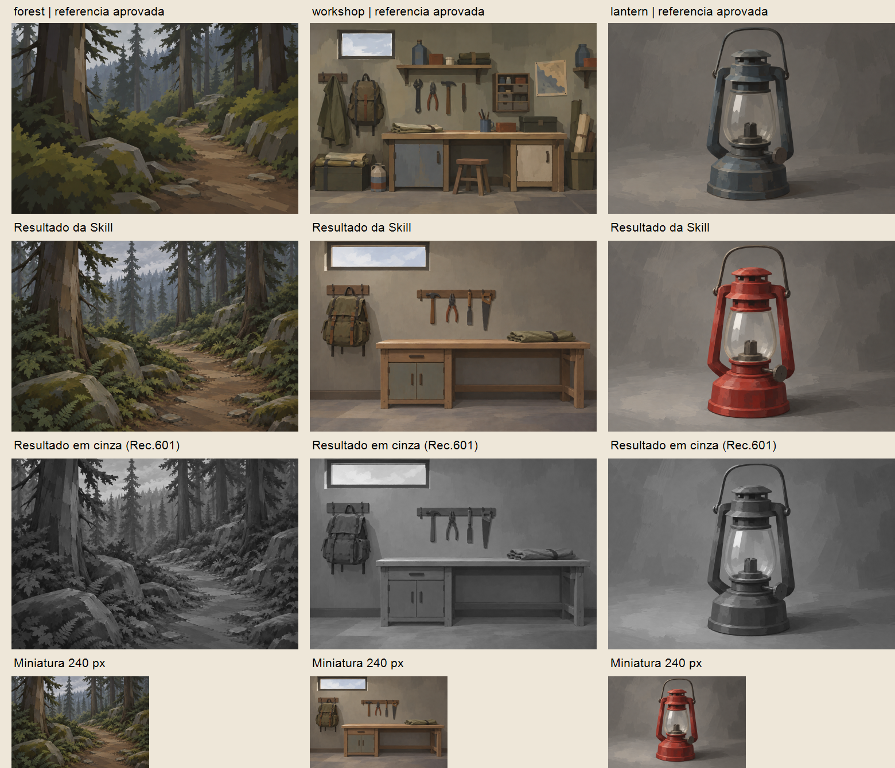

# Validação da Skill guardian-bay-illustration

Continuação: [rodada 02 — correção de simplificação e novo teste](round-02/README.md). Este relatório mantém o histórico da primeira rodada.

25/10/2026. [Skill criada](../../../../.agents/skills/guardian-bay-illustration/SKILL.md) na estrutura `.agents/skills/`, com um único SKILL.md, sem cópias de documentação ou imagens no pacote. Perfil e contrato 1.0.0 foram mantidos. O catálogo de skills do host passou a listar seu nome/descrição nesta sessão; isso comprova descoberta nesta sessão, não seleção automática em toda instalação.

## Resultado

**Estrutura e preparação verificadas; validação visual parcial do fluxo textual. Transformação fotográfica pendente.** Três imagens foram realmente geradas e examinadas, mais uma edição direcionada da oficina. Elas são testes, não novas referências oficiais aprovadas pelo usuário. Nenhuma substitui as artes existentes.

- [Floresta](forest.png)
- [Oficina revisada](workshop.png), com [primeira saída rejeitada](workshop-initial.png) preservada como evidência
- [Lanterna vermelha](lantern.png)
- [Comparação com as referências, cinza e miniaturas](comparison.png)
- [Pedidos validados](requests.json) e [prompts/parâmetros integrais](prompts.md)

## Organização e funcionamento

A Skill lê fontes existentes e traduz o contrato em instruções legíveis, identificando alvo e referências. O fluxo A examina origem e preserva inventário, geometria, composição e luz salvo permissões explícitas. O fluxo B especifica uma cena original com as mesmas regras de estilo. Ambos verificam saída, registram limites e encerram após no máximo uma revisão direcionada quando há falhas persistentes. Não presumem que o modelo execute JSON diretamente.

Invocação: `Use $guardian-bay-illustration para criar uma ilustração de [assunto], com [finalidade] e [formato].` Para transformar, anexar a origem e explicitar o que preservar/alterar. O SKILL.md pode ser carregado explicitamente se o cliente não o listar. Fotografias comerciais fiéis e implementação de e-commerce ficam fora do escopo.

## Ensaios de comportamento

Antes da escrita, um agente independente recebeu os três pedidos fotográficos existentes sem a Skill nova. Identificou corretamente que as fotos eram placeholders e interrompeu as transformações dependentes. **O baseline passou:** não há evidência de falha anterior nem de melhora causal da Skill nesse cenário; não se fabricou um teste vermelho.

Após a escrita, outro agente em contexto novo aplicou explicitamente a Skill aos seguintes casos, somente em preparação, sem gerar imagens:

| Caso | Resultado observado |
| --- | --- |
| `forest-photo`, `workshop-photo`, `lantern-photo` sem anexos | Reconheceu IDs sem fotos; não usou artes aprovadas como origens nem converteu silenciosamente para texto. |
| Preparar `skill-lantern-text` | Localizou perfil e referências, separou seus papéis, manteve vermelho solicitado, montou prompt natural e chamada com três caminhos locais, sem inventar modelo/seed. |
| Origem com enquadramento preservado e saída 4:5 | Escolheu `contain_source` com margens neutras, sem crop/outpainting; exigiria origem real para avaliar preservação. |

Capacidade solicitada aos agentes: gpt-6.1-sol/medium; configuração efetiva não inferida. A revisão independente confirmou sete links da Skill, schema dos pedidos/perfil e três hashes. Não é prova de execução da ferramenta por outro agente nem avaliação visual independente das saídas abaixo.

## Testes visuais efetivamente executados

Os IDs de foto da Task anterior não têm arquivos vinculados. Portanto, os três assuntos foram configurados explicitamente como **novos pedidos textuais**, usando a mesma identidade 1.0.0 e o mesmo conjunto de três referências locais. Isso testa o fluxo B e evita fingir um teste foto → ilustração do fluxo A. Não se geraram fotos sintéticas para preencher essa lacuna.

As chamadas usaram `prompt`, `referenced_image_paths` e `transparent_background: false`. Sem controles expostos de modelo, seed ou resolução; tamanho solicitado na prosa, confirmado em todos os arquivos como 1536 × 1024. A oficina exigiu uma edição adicional, direcionada a retirar conteúdo não pedido. Nenhuma outra rodada foi iniciada.

Inspeção das saídas originais exibidas pela ferramenta, comparação com os PNGs aprovados e prancha com miniaturas de 240 px/cinza. A prancha foi composta com System.Drawing já disponível, sem dependências instaladas; cinza usa Rec.601 sobre RGB e não é medição de contraste WCAG. Não houve filtros de acabamento ou testes de banners, pois a finalidade é validar a Skill.

| Critério | Floresta | Oficina após revisão | Lanterna |
| --- | --- | --- | --- |
| Formas | **Aprovado:** trilha, troncos e pedras reconhecíveis por planos. | **Aprovado:** bancada apoiada, armário e quatro ferramentas legíveis. | **Aprovado:** pega ligada, suportes, base e câmara legíveis; plausibilidade ilustrativa, não projeto mecânico. |
| Pinceladas | **Parcial:** planos maiores nos troncos, mas marcas menores aumentam na vegetação. | **Parcial:** planos amplos e detalhes simples, algumas superfícies parecem mais lisas que a referência. | **Aprovado:** marcas por planos no próprio corpo e na câmara, não apenas no fundo. |
| Bordas | **Aprovado:** definição cai no fundo. | **Parcial:** peças têm bordas predominantemente firmes. | **Parcial:** contorno quase todo firme. |
| Materiais/texturas | **Parcial:** há folhas/frondes pequenas mais enumeradas que o desejado. | **Aprovado:** lona por dobras, madeira por planos; revisão reduziu marcas de desgaste. | **Parcial:** metal fosco coerente; vidro ainda relativamente opaco. |
| Cores | **Aprovado:** massas acinzentadas e terras contidas, sem feixe dourado. | **Aprovado:** neutros e olivas contidos. | **Parcial:** manteve o vermelho em vez de herdar o azul, porém realces avermelhados são mais vivos que na referência. |
| Luz | **Aprovado:** distância clara, sombra próxima coerente. | **Aprovado:** janela alta e sombras amplas sem brilho polido. | **Aprovado:** luz esquerda e sombra para direita apoiam o volume. |
| Profundidade | **Aprovado:** camadas por oclusão e contraste. | **Aprovado:** ambiente raso e bancada com volume simples. | **Aprovado:** apoio e sombra bastam ao objeto isolado. |
| Acabamento/detalhe | **Parcial:** ainda denso na folhagem. | **Parcial:** objetos principais simples, mas mochila continua com manchas pequenas. | **Parcial:** sem minúcia mecânica generalizada, mas composição e estrutura ficaram muito próximas da referência. |

**Conteúdo:** a primeira oficina foi reprovada por acrescentar planta, prateleiras, caixas, recipientes e banco fora do pedido. A única revisão removeu os extras e manteve os quatro utensílios, bancada/armário, mochila, lona e janela; conteúdo aprovado após correção. Essa edição demonstra capacidade de correção localizada de uma imagem gerada, não preservação de uma fotografia.

**Consistência global: Parcial.** Há parentesco de planos, materiais simplificados e cor fosca, mas a densidade de detalhe varia. Floresta e lanterna ficaram próximas demais das próprias referências em organização/silhueta; a lanterna vermelha comprova mudança de cor sem perder o tratamento, mas não prova liberdade ampla de composição. Sem apontar cópia de propriedade exclusiva de terceiros, essa proximidade limita a evidência de generalização e recomenda revisão do usuário antes de novo lote. As referências fixas não foram modificadas para acomodar essas limitações.

## Checks estruturais e limites

- Perfil, coleção de três pedidos e pedidos individuais: validação com `z.fromJSONSchema` já instalado; hashes das três artes aprovadas conferidos.
- `quick_validate.py` da skill-creator foi executado, mas não concluiu por ausência de PyYAML no Python disponível. Não se instalou pacote nem se alegou aprovação desse comando. Nome, frontmatter simples, limites de descrição, cercas Markdown, placeholders e links foram verificados localmente por checks determinísticos e inspeção independente.
- O novo JSON de pedidos não declara `$schema` relativo: fica numa subpasta, enquanto o contrato restringe a anotação a um caminho relativo à pasta principal. A validação é feita carregando explicitamente `docs/design/illustration-contract.schema.json`, sem alterar o contrato nem criar cópia do schema.
- Preservação fotográfica real continua **não testada**: faltam fotos autorizadas vinculadas a `forest-photo-source`, `workshop-photo-source` e `lantern-photo-source`. O schema, as referências e a edição de teste não substituem essa evidência.
- Sem teste de repetibilidade por seed/modelo ou entre provedores. Sem aprovação comercial, acessibilidade ou publicação. A avaliação visual foi feita pelo agente implementador; a independente cobriu preparação e limites, não os pixels gerados.

Próxima ação sugerida: revisar as três saídas, especialmente a densidade da floresta e a proximidade da lanterna com a referência, e fornecer fotos reais para validar o fluxo A numa Task própria. Não houve mudança no e-commerce.
